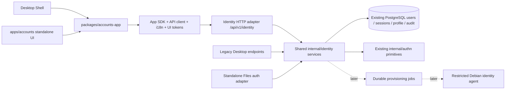

# IDENTITY ARCHITECTURE — Đề xuất chờ duyệt

Phase 0, 2026-10-30. Đây là thiết kế, không phải tính năng đang chạy. Phải duyệt trước code/schema changes.

## 1. Kiến trúc theo monorepo thực tế

Modular monolith/library trong Go binaries hiện có; không thêm daemon Identity, PostgreSQL, Redis hoặc worker ngay.
internal/identity không import internal/platform, Desktop/Pinia hoặc business Files. internal/identityhttp là adapter
net/http được đăng ký trong backend hiện có qua middleware/dependency interfaces. Drive link cùng library/repository;
không gọi Desktop HTTP để xác thực. PostgreSQL dùng chung khi integrated; standalone Drive vẫn tự khởi tạo được.

Frontend mới: packages/accounts-app sở hữu business UI và accounts.* catalogs; apps/accounts là thin standalone host
minhanos-accounts. Desktop AppContent chỉ mount component. Route standalone dự kiến /accounts/ do cùng Go backend
phục vụ riêng, hoạt động khi Shell JS hỏng; không thêm session store. Backend outage dùng local-console recovery,
không hứa UI hoạt động khi chính backend dừng. Không thêm iframe hoặc mount logic tài khoản trong Shell.

## 2. Authentication engine được đề xuất

Giữ native Go engine/session server-side hiện có, tái cấu trúc thành Shared IdentityService và AuthenticationEngine
interface. Password verification tiếp tục internal/authn dùng crypto/pbkdf2 chuẩn của Go; không thay thuật toán trong
Phase 1, không bắt người dùng reset hàng loạt, không tự viết crypto/JWT/OIDC. Password hash vẫn có đúng một nơi lưu.

Lý do: đã có users/session/cookie/CSRF, runtime nhỏ, hai host cần tái sử dụng và không có nhu cầu cài IAM bên ngoài.
Đây không phải tuyên bố engine hiện tại đã được audit production; phase hardening và regression tests là bắt buộc.
OWASP ưu tiên Argon2id cho hệ thống mới và có hướng dẫn PBKDF2-HMAC-SHA256 600000 iterations trong bối cảnh FIPS;
việc giữ format hiện tại phục vụ compatibility, không chứng nhận FIPS. Bổ sung algorithm/cost metadata và benchmark
trước khi cân nhắc reader dual-format/rehash-on-login bằng thư viện được kiểm chứng.
Nguồn: [Go standard PBKDF2](https://pkg.go.dev/crypto/pbkdf2),
[OWASP Password Storage](https://cheatsheetseries.owasp.org/cheatsheets/Password_Storage_Cheat_Sheet.html).

SessionService bọc hai realms hiện có. V0.1 không tạo bảng session thứ ba. Mỗi realm có public opaque session handle
khác bearer secret, metadata first/last seen, UA/device hint, auth method và revoke status; handle bao gồm realm
nội bộ để tránh nhầm session. Mọi lookup/revoke xác minh owner hoặc quyền sessions.manage backend.
Không lưu token vào localStorage; UA/IP chỉ là metadata, không được coi là device authentication.

Disable/reset/password change phải chặn cả Desktop, Drive standalone và native gateway. Revoke all session rows của
user trong một transaction và kiểm active/auth epoch ở mọi adapter. Đổi mật khẩu V0.1 yêu cầu đăng nhập lại tất cả
realms, kể cả current session; tránh giữ client CSRF cũ sau rotation. UI báo rõ và xử lý session invalidation tập trung.
Long transfers cần reauthorize trước commit; không hứa kill ngay mọi byte đang stream.

## 3. UUID và schema dự kiến

**Chọn UUID công khai trong cùng users row, giữ legacy physical PK/storage key.**
Contract User.id v1 lấy users.public_id UUIDv4 bất biến. Legacy /api vẫn trả users.id hex64;
repo ánh xạ server-side public UUID → legacy ID để query phiên/FK/storage. Không đổi tên /data/users/<legacy-id>,
không chown/chmod dữ liệu cũ. Không dùng username/email làm khóa và không tạo identity_users trùng users.
UUID generation dùng PostgreSQL gen_random_uuid, không tự tạo thuật toán:
[PostgreSQL 18 UUID](https://www.postgresql.org/docs/18/functions-uuid.html).
Nếu bắt buộc physical PK UUID ngay, phải duyệt một migration rekey riêng; đây không phải lựa chọn mặc định.

| Model/table target | Dữ liệu và ràng buộc | Cách tiếp cận |
|---|---|---|
| User / users | public_id uuid unique, status active/disabled/deleted, version/auth_epoch, timestamps | Extend existing row; giữ id, username, password_hash, legacy role |
| Group / identity_groups | UUID, name unique theo policy canonical, system/user kind, version | New identity-owned table; chưa nested groups V0.1 |
| Membership / identity_group_members | group UUID + users.public_id unique pair | Không duplicate user state |
| Role / identity_roles | UUID/stable key, system/custom, protected flag, version | Seed reserved roles có version |
| Permission / identity_role_permissions | role + registered permission key | Registry allowlist; không nhận wildcard tùy ý |
| RoleBinding / identity_role_bindings | role + user hoặc group subject + scope | Exclusive subject fields; backend scope checks |
| AppAccess / identity_app_access | app ID + user/group/role + scope/effect | User may launch app; tách khỏi app capability grants |
| AppGrant / identity_app_grants | verified app + action/resource scope + policy version | Manifest request không phải grant; untrusted apps deferred |
| Session / existing two tables | public handle metadata, last seen, expiry/revocation, epoch | Realm adapters; không thêm third canonical store |
| CredentialRef / metadata | UUID reference, user, kind, scheme/params, timestamps | Password secret vẫn users.password_hash; không trả hash/salt |
| IdentityLink | provider ID + external subject unique → user UUID | Reserve schema design; linking flow later, không auto-link theo email |
| LinuxIdentity | user UUID, node/storage scope, uid/gid reservation, state, version | Later; tombstone giữ UID/GID, không provision lúc tạo web user |
| AuditEvent / existing audit | event ID, verified actor UUID, action/target/outcome, requestId, sanitized details | Adopt/extend existing audit; reader liên kết legacy Drive events |

Tables mới dùng UUID và references tới users.public_id sau unique/backfill gate. Trong giai đoạn expand có thể nullable;
API v1 không được bật với user chưa có UUID. Không seed memberships/privilege từ dữ liệu frontend.
Sessions/credential secrets và audit reader được che theo permission; public DTO không lộ token hash/CSRF người khác.

## 4. Authorization và role policy

Allow = active subject AND user permission/scope AND user app access AND verified app grant AND resource ACL/storage
policy, thêm recent-auth khi thao tác nhạy cảm. Deny là mặc định. Backend suy subject từ session/token đã kiểm tra.
App ID frontend/header chỉ là dữ liệu yêu cầu; không phải bằng chứng principal.

Native apps trong cùng origin là trusted code. Server inject app context theo registered endpoint/host adapter chỉ
là operation context, không chứng minh JavaScript nào đã gọi. Không quảng cáo app isolation trước khi có sandbox/
origin isolation và delegation audience/resource/expiry-bound. Third-party app support bị khóa tới phase bảo mật riêng.
Application Registry không phải OAuth Client Registry.

| Role | Quyền dự kiến | Giới hạn |
|---|---|---|
| System Admin | Quản lý Identity/policy và cấu hình nền tảng | Không mặc định read-any-personal-file hoặc host root |
| User Admin | Quản lý Standard Users trong phạm vi cấp | Không tự nâng quyền, tạo System Admin hoặc quản lý protected bindings |
| Storage Admin | Storage policy/provisioning theo scope | Không tự đọc private contents |
| Standard User | My Account, own sessions/password, own Files khi được cấp app | Không sửa role/quyền hoặc đọc user khác |
| Guest | Tập quyền tối thiểu đã cấp | Không bật public guest/anonymous login mặc định |

V0.1 System Admin binding chỉ trực tiếp tới user; không cho nhóm/custom role cấp gián tiếp System Admin cho đến
khi last-admin invariant qua tất cả mutation paths. Last-admin check dùng transaction và lock chung, bao phủ disable,
soft-delete, demote, binding/group/role updates, không chỉ nút Delete. Reserved roles bảo vệ và User Admin có permission ceiling.

Trước khi cho tạo/quản lý System Admin mới, Files system-root guard phải tách khỏi users.role='admin'.
Migration quyền host hiện tại cần duyệt: bảo toàn operator cũ bằng binding rõ ràng, không cấp host-root tự động cho
System Admin mới. Các root chứa dữ liệu app/private/secret hoặc cấu hình thực thi cần allowlist/reauth policy riêng.
Host root/DBA thực vẫn là trusted operator, không thể bị chặn chỉ bằng web ACL. Không cam kết privacy chống host root.

## 5. API và client dự kiến — chưa tồn tại

Prefix /api/v1/identity, OpenAPI 3.1, nested error {error:{code,message,requestId,details}}.
Backend sinh correlation ID; 401 unauthenticated, 403 forbidden, 404 filtered/missing object,
409 uniqueness/idempotency/last-admin conflict, 412 stale version, 428 missing precondition,
422 semantic validation, 429 throttled. Responses không đưa credential material vào details.

| Endpoints dự kiến | Quyền/behavior |
|---|---|
| GET /me, PATCH /me | Self-only safe fields, If-Match; role/status không mass assign |
| GET/POST /users; GET/PATCH /users/{uuid} | Scoped identity.users.*; cursor/search/field allowlist |
| POST /users/{uuid}/disable, /enable | Protected admin invariant + revoke all + audit + idempotency |
| DELETE /users/{uuid} | Soft-delete workflow sau disable; giữ ownership/tombstones |
| GET/POST/PATCH /groups và /groups/{uuid}/members | Group management theo scope, version/preconditions |
| GET/POST/PATCH /roles; /role-bindings | Protected roles, permission ceiling, recent auth |
| GET /permissions, /applications; app-access bindings | Real registry + allowlisted permissions; không mock installed apps |
| GET /me/sessions, DELETE /me/sessions/{handle}, POST /me/sessions/revoke-others | Owner from verified session; never expose bearer secret |
| GET /users/{uuid}/sessions, revoke | Separate admin permission, reauthentication/audit |
| POST /me/password, /reauthenticate | Current credential check, bounded attempts, no logging secrets |
| POST /password-reset-requests, /password-resets | TTL/single-use hashed token; only enable with verified delivery or local/admin workflow |
| GET /audit-events | Cursor + authorized actor/target filtering, privacy redaction |
| GET /users/{uuid}/linux-identity | Status only until provisioning worker exists |

Mutations needing replay protection bind Idempotency-Key to actor/app/route/body hash, reauthorize every replay.
Lists use opaque cursor bound to filters/sort/subject; limit 1..100, stable tie-breaker. Optimistic concurrency uses
ETag/If-Match. Legacy endpoints retain schemas/cookies and delegate to same service before new policies go live.
Generated types + generated typed client planned; existing generic api-client alone is not a generated Identity SDK.

## 6. Manifest, UI và lifecycle

ID com.minhanos.account-center; module minhanos-accounts; initial app version 0.1.0; sdk ^0.1.0;
logical native entrypoint /apps/account-center; standalone route /accounts/; window/maximized/fullscreen declarations.
New optional manifest navigation/settingsIntegration metadata needs a backward-compatible schema extension:
current schema rejects unknown properties. Do not add an invalid runtime manifest during Phase 0.

Required requested capabilities identity.users.*, identity.groups.*, identity.roles.*, identity.apps.*, identity.sessions.*,
identity.audit.read must become concrete registry keys in Phase 1, never wildcard grants. Permission-gated nav owns
accounts.* vi/en strings; no Desktop-owned accounts vocabulary. Native/standalone share one business component.

Sidebar target: Overview, Users, Groups, Roles & Permissions, Application Access, Sessions & Devices, Security, Audit.
My Account sees self endpoints; administrative views require backend grants. Unsupported features show truthful
capability status, not fake data/actions. SDK lifecycle extension needs async requestClose while accepting existing
Files boolean guards; Home/switch/minimize retain draft/state. No business imports of Desktop store/components.

## 7. Recovery, POSIX và roadmap boundary

Standalone Accounts UI is the browser fallback when Shell fails. Local-console-only recovery is needed for backend
or admin lockout: OS-root/operator verification, short TTL single-use recovery, audit/redaction, no public root API.
Self-service email reset remains disabled without verified address + delivery configuration; no pretend email success.
MFA/WebAuthn are extension points until maintained-library integration/security tests; V0.1 does not claim support.

Web account, POSIX owner, SMB identity and SSH permission are separate. System provisioning waits for durable
PostgreSQL jobs, leases/fencing/idempotency/reconciliation. Agent uses authenticated service identity, typed operations,
per-request policy/job binding and root allowlists; actor header is not authority. No shell endpoint or manual edits
of passwd/group/shadow, no default SSH shell, no UID/GID reuse after ownership without recovery policy.
A failed Linux provision must leave the web user valid with explicit failure/retry state; no DB/host distributed atomicity promise.

## 8. Tham khảo Authentik, thiết kế độc lập

Đã đọc repository chính thức và core model: tham khảo tách user/group/role, application/provider và public session
reference khỏi secret. Không fork/copy source hoặc dùng model/license làm nền cho implementation.
[Repository](https://github.com/goauthentik/authentik), [core models](https://github.com/goauthentik/authentik/blob/main/authentik/core/models.py).

Các ý học để áp dụng chọn lọc: identity bên ngoài tách bằng nguồn liên kết; chính sách gắn vào target;
audit có redaction; recovery có TTL. V0.1 dùng luồng login cố định thay vì Flow Designer.
Nguồn chính thức: [Users](https://docs.goauthentik.io/users-sources/user/),
[Providers](https://docs.goauthentik.io/add-secure-apps/providers/),
[Sources](https://docs.goauthentik.io/users-sources/sources/),
[Policies](https://docs.goauthentik.io/customize/policies/),
[Flows](https://docs.goauthentik.io/add-secure-apps/flows-stages/flow/),
[Events](https://docs.goauthentik.io/sys-mgmt/events/),
[Recovery](https://docs.goauthentik.io/troubleshooting/login/).
Đây là phân tích kiến trúc từ nguồn chính thức, không phải đánh giá toàn bộ Authentik hoặc chứng nhận bảo mật MinhAnOS.
